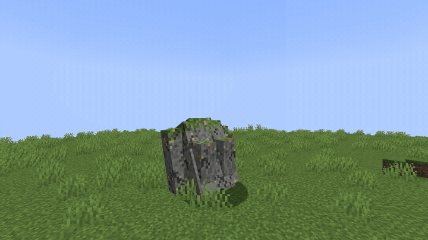
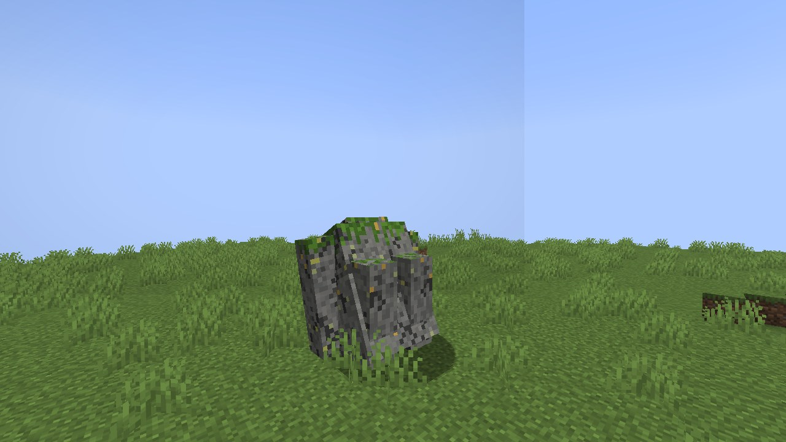
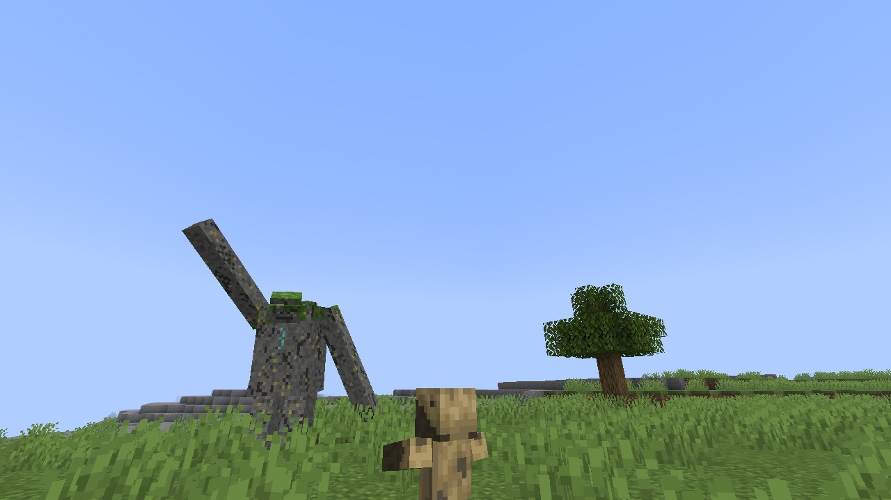
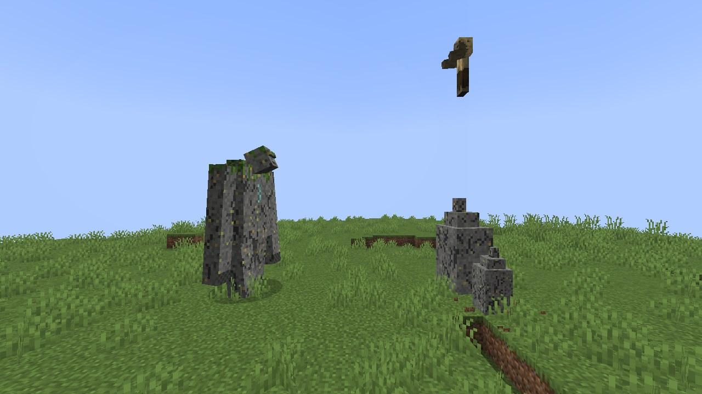
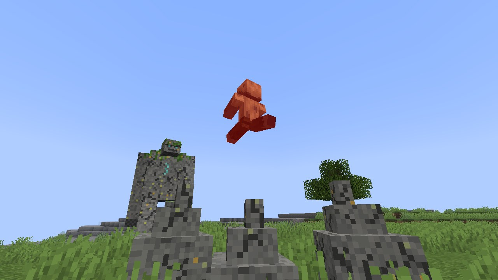
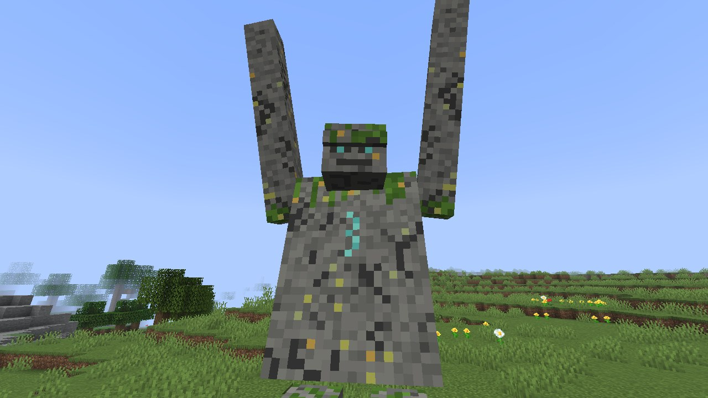
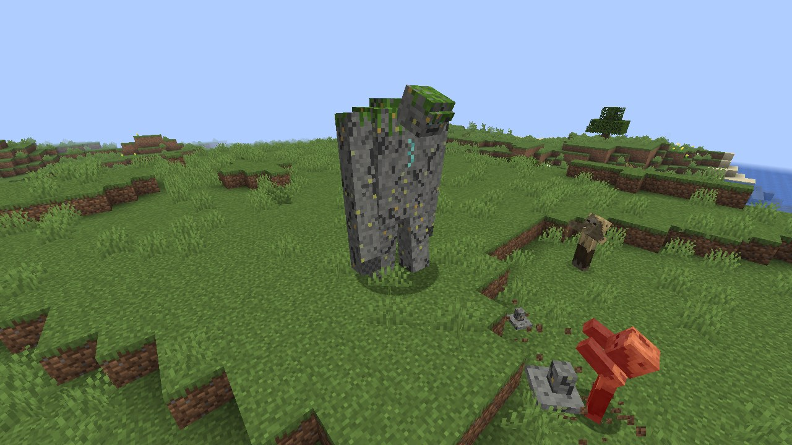
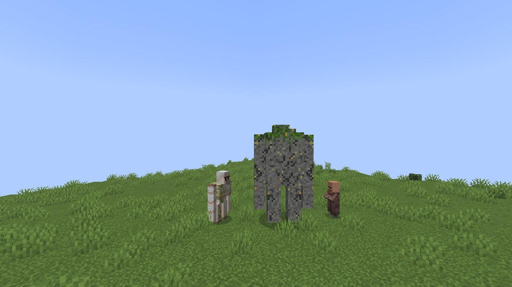
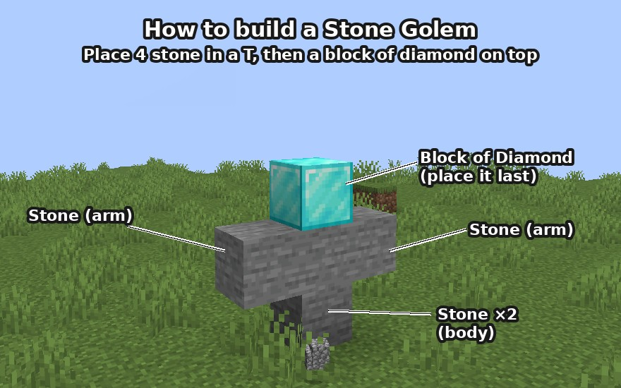
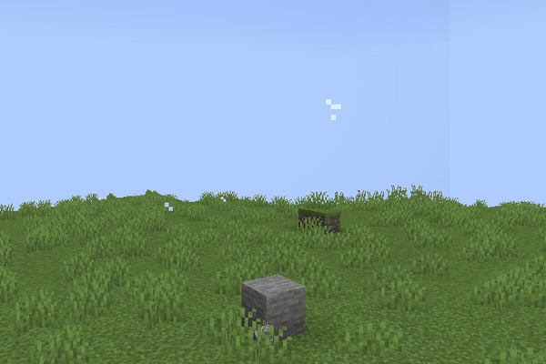

# Stone Golem

**An ancient guardian sleeps in the stone. Wake it, and the earth itself rises against you.**

A new mob for **Minecraft Java 26.3** (Fabric and NeoForge) and **Minecraft Bedrock 1.26.50+** (add-on for phones, tablets, consoles and Windows).



▶ **[Watch the showcase video](docs/media/showcase.mp4)** (22 s)

## What it does

You find it as a mossy boulder, deep in stone caves or on rocky mountain slopes. Hit it, or mine stone right next to it, and it slowly heaves itself up: a 5½-block colossus, twice the height of an iron golem.

| | |
|---|---|
|  |  |
| **Dormant.** It sleeps as a boulder: no movement, no sound. | **Rock summon.** From a distance it raises one hand; the ground beneath you crumbles… |
|  |  |
| **…and stone pillars burst out of the earth**, hurling you 8 blocks into the air before they sink back. Step aside in time and they miss. | The fall hurts: bring feather falling, water or quick reflexes. |
|  |  |
| **Ground stomp.** Up close it leans back, raises both arms and smashes the ground, throwing everything around it into the air. | **Against a crowd** it mixes pillars, stomps and ground slams — two fists into the ground right in front of it. |



## Build your own guardian

Like an iron golem, you can build a Stone Golem: **four stone in a T** (two stacked for the body, one on each side as arms) and a **block of diamond on top, placed last**. Grass and flowers next to the leg do not get in the way.





A built golem is your **guardian**: it never attacks players (not even when hit), never goes back to sleep, does not despawn, and hunts monsters around it with all three attacks — its rock pillars leave players alone. *(Java edition; coming to Bedrock next.)*

## Features

- **Neutral, until provoked.** It only fights whoever attacked it, and settles back into a boulder after 30 seconds without a target.
- **Wakes up** when attacked or when someone mines stone or ore within 4 blocks.
- **Three attacks**: ground slam (6 hearts on Normal), telegraphed ground stomp (area damage, 8 s cooldown) and the rock summon (4–16 blocks, 10 s cooldown).
- **Bring a pickaxe.** Pickaxes deal double damage; swords and arrows only half. Driven by tags, so packs and other mods can change what counts.
- Immune to knockback, fall damage and drowning; invulnerable while standing up.
- **Spawns rarely**, one at a time: in stone caves below Y 40 and on stony mountain surfaces.
- **Buildable** from four stone and a block of diamond as a guardian that protects players (blocks are data-driven via `#stonegolem:stone_golem_body` / `#stonegolem:stone_golem_head`).
- **Drops** cobblestone, moss and, rarely (more with Looting), a pulsing **Golem Core** — the key to a future update.
- English and German.

## Download and install

Releases will be published here and on Modrinth and CurseForge.

- **Fabric**: install [Fabric Loader](https://fabricmc.net/) and [Fabric API](https://modrinth.com/mod/fabric-api), then put `stonegolem-fabric-26.3-<version>.jar` into your `mods` folder.
- **NeoForge**: put `stonegolem-neoforge-26.3-<version>.jar` into your `mods` folder.
- **Bedrock**: open `StoneGolem-<version>.mcaddon` on your device, then enable *Stone Golem* under *Behavior Packs* when creating or editing a world.

Spawn it with its spawn egg (creative inventory) or `/summon stonegolem:stone_golem`.

## License

Free and open: code and assets are under the [MIT license](LICENSE). Modpacks, videos and forks are welcome.

---

## For developers

Requires nothing but a JDK to start Gradle; Gradle downloads JDK 25 for itself and the build (see `gradle/gradle-daemon-jvm.properties`).

```bash
./gradlew build                        # jars in fabric/build/libs and neoforge/build/libs
./gradlew :fabric:runClient            # or :neoforge:runClient
./gradlew :fabric:runGametest          # headless game tests (also :neoforge:runGameTestServer)
./gradlew :fabric:runClientGametest    # scripted client smoke test
./gradlew :fabric:runClientShowcase    # renders the README media (see StoneGolemShowcase)
python3 bedrock/build.py               # Bedrock add-on -> bedrock/dist/*.mcaddon
```

See [TESTING.md](TESTING.md) for the manual checklist, [ROADMAP.md](ROADMAP.md) for what comes next and [bedrock/README.md](bedrock/README.md) for the Bedrock edition.

| Module     | Contents |
|------------|----------|
| `common`   | All gameplay: entity, AI, state machine, model, animations, renderer, tags, loot, assets, game tests. Vanilla code only. |
| `fabric`   | Entry points, registration, biome modification, events, test wrappers, showcase. |
| `neoforge` | Entry points, registration, biome modifier type, events, test registration. |
| `bedrock`  | Behavior and resource pack, Script API code, build script, GameTests. |

- **Balancing**: every Java number lives in [`StoneGolemBalance`](common/src/main/java/eu/ariakan/stonegolem/config/StoneGolemBalance.java), every Bedrock number in [`bedrock/balance.json`](bedrock/balance.json).
- **Loader abstraction**: `IRegistrar` and `IPlatformHelper` services (Java `ServiceLoader`), implemented per loader.
- **Art**: [`tools/generate_textures.py`](tools/generate_textures.py) produces the first-draft textures. The model uses Blockbench-style part names (`body`, `head`, `left_arm`, `right_arm`, `left_leg`, `right_leg`); animations follow Blockbench's Java export format.

Built on [jaredlll08/MultiLoader-Template](https://github.com/jaredlll08/MultiLoader-Template). Mod ID `stonegolem`, package `eu.ariakan.stonegolem`.
